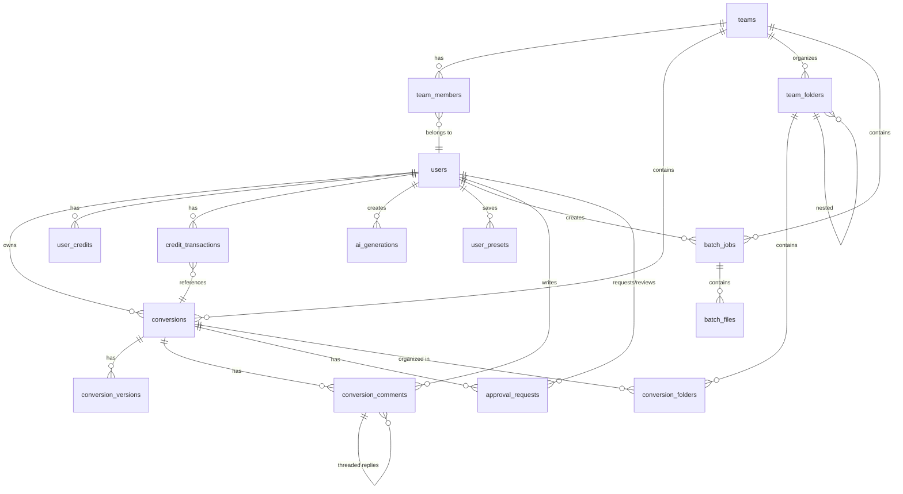

# Vectorr Database Schema — Phase 1

**Version**: 2.0  
**Date**: 2026-11-02  
**Target**: Supabase (PostgreSQL 15+)

---

## Overview

This schema supports Vectorr Phase 1: **Image Vectorization SaaS** (PNG/JPG → SVG conversion).

**Key Features**:
- Credit-based billing system
- Team workspaces with role-based access
- Batch processing (up to 50 files)
- Version history for iterative refinement
- AI-powered generation tools
- Threaded comments and approval workflows

---

## Entity Relationship Diagram



---

## Table Descriptions

### Core Tables

#### `conversions`
**Purpose**: Core vectorization jobs (PNG/JPG → SVG)

| Column | Type | Description |
|--------|------|-------------|
| `id` | uuid | Primary key |
| `user_id` | uuid | Owner (references `auth.users`) |
| `team_id` | uuid | Team workspace (nullable) |
| `original_file_url` | text | Source image URL |
| `converted_file_url` | text | Result SVG URL (nullable until complete) |
| `original_format` | text | Input format: png, jpg, jpeg, webp, gif, heic, tiff, bmp |
| `output_format` | text | Output format: svg, dxf, eps, ai, pdf, cdr, lottie, dst, pes, jef, gcode |
| `preprocessing` | jsonb | Options: `{remove_bg: true, upscale: "2x", destination: "cricut"}` |
| `status` | text | Job status: pending, processing, complete, failed |
| `credits_used` | numeric(5,2) | Credits deducted (default: 0.20) |
| `job_id` | text | BullMQ job ID for async polling |
| `error_message` | text | Error details if failed |
| `metadata` | jsonb | File info: `{width, height, file_size, colors}` |
| `created_at` | timestamptz | Job creation time |
| `completed_at` | timestamptz | Job completion time (nullable) |

**Indexes**:
- `user_id` (fast user lookups)
- `status` (filter by job state)
- `team_id` (team conversions, partial index)
- `created_at` (recent jobs)

---

#### `user_credits`
**Purpose**: Credit balance and subscription tier

| Column | Type | Description |
|--------|------|-------------|
| `user_id` | uuid | Primary key (references `auth.users`) |
| `balance` | numeric(6,2) | Current credit balance (≥ 0) |
| `tier` | text | Subscription tier: free, starter, plus, pro, team, agency |
| `subscription_id` | text | Stripe subscription ID |
| `subscription_status` | text | Stripe status: active, canceled, past_due, trialing |
| `updated_at` | timestamptz | Last balance update |

**Constraints**:
- `balance >= 0` (no negative balances)

---

#### `credit_transactions`
**Purpose**: Audit log of all credit movements

| Column | Type | Description |
|--------|------|-------------|
| `id` | uuid | Primary key |
| `user_id` | uuid | User (references `auth.users`) |
| `amount` | numeric(6,2) | Credit amount (negative = deduction, positive = addition) |
| `balance_after` | numeric(6,2) | Balance after transaction |
| `reason` | text | Transaction reason: conversion, purchase, refund, subscription, bonus, batch_conversion, ai_generation |
| `conversion_id` | uuid | Related conversion (nullable) |
| `stripe_payment_intent` | text | Stripe payment intent ID (nullable) |
| `created_at` | timestamptz | Transaction timestamp |

**Indexes**:
- `user_id` (user transaction history)
- `created_at` (recent transactions)

---

### Team Tables

#### `teams`
**Purpose**: Team workspaces for collaborative vectorization

| Column | Type | Description |
|--------|------|-------------|
| `id` | uuid | Primary key |
| `name` | text | Team name |
| `owner_id` | uuid | Team owner (references `auth.users`) |
| `plan` | text | Team plan: team_starter, team_pro, agency |
| `subscription_id` | text | Stripe subscription ID |
| `created_at` | timestamptz | Team creation time |
| `updated_at` | timestamptz | Last update time |

---

#### `team_members`
**Purpose**: Team membership with role-based access

| Column | Type | Description |
|--------|------|-------------|
| `team_id` | uuid | Team (references `teams`) |
| `user_id` | uuid | User (references `auth.users`) |
| `role` | text | Member role: admin, editor, viewer |
| `joined_at` | timestamptz | Join timestamp |

**Primary Key**: `(team_id, user_id)`

**Roles**:
- **admin**: Full access (manage members, delete team)
- **editor**: Create/edit conversions, manage folders
- **viewer**: Read-only access

---

#### `team_folders`
**Purpose**: Hierarchical folder structure for team organization

| Column | Type | Description |
|--------|------|-------------|
| `id` | uuid | Primary key |
| `team_id` | uuid | Team (references `teams`) |
| `name` | text | Folder name |
| `parent_id` | uuid | Parent folder (nullable, for nesting) |
| `created_by` | uuid | Creator (references `auth.users`) |
| `created_at` | timestamptz | Creation timestamp |

---

#### `conversion_folders`
**Purpose**: Many-to-many relationship between conversions and team folders

| Column | Type | Description |
|--------|------|-------------|
| `conversion_id` | uuid | Conversion (references `conversions`) |
| `folder_id` | uuid | Folder (references `team_folders`) |
| `added_at` | timestamptz | Added timestamp |

**Primary Key**: `(conversion_id, folder_id)`

---

### Version History

#### `conversion_versions`
**Purpose**: Version history for iterative refinement

| Column | Type | Description |
|--------|------|-------------|
| `id` | uuid | Primary key |
| `conversion_id` | uuid | Conversion (references `conversions`) |
| `version_number` | int | Version number (1, 2, 3, ...) |
| `checkpoint_name` | text | Checkpoint label: "Before client feedback", "Final approved" |
| `file_url` | text | Version file URL |
| `metadata` | jsonb | Version metadata |
| `created_by` | uuid | Creator (references `auth.users`) |
| `created_at` | timestamptz | Creation timestamp |

**Unique Constraint**: `(conversion_id, version_number)`

---

### Batch Processing

#### `batch_jobs`
**Purpose**: Batch processing jobs (up to 50 files)

| Column | Type | Description |
|--------|------|-------------|
| `id` | uuid | Primary key |
| `user_id` | uuid | Owner (references `auth.users`) |
| `team_id` | uuid | Team workspace (nullable) |
| `status` | text | Job status: pending, processing, complete, failed, partial |
| `total_files` | int | Total files in batch (1-50) |
| `completed_files` | int | Completed files count |
| `failed_files` | int | Failed files count |
| `zip_url` | text | Generated ZIP archive URL |
| `zip_expires_at` | timestamptz | ZIP expiry (24 hours) |
| `preprocessing` | jsonb | Batch preprocessing options |
| `created_at` | timestamptz | Job creation time |
| `completed_at` | timestamptz | Job completion time (nullable) |

---

#### `batch_files`
**Purpose**: Individual files within a batch job

| Column | Type | Description |
|--------|------|-------------|
| `id` | uuid | Primary key |
| `batch_id` | uuid | Batch job (references `batch_jobs`) |
| `file_url` | text | Source file URL |
| `status` | text | File status: pending, processing, complete, failed |
| `result_url` | text | Result file URL (nullable) |
| `error_message` | text | Error details if failed |
| `credits_used` | numeric(5,2) | Credits deducted for this file |
| `created_at` | timestamptz | Creation timestamp |
| `completed_at` | timestamptz | Completion timestamp (nullable) |

---

### AI Tools

#### `ai_generations`
**Purpose**: AI-powered generation jobs (logo, SVG, pattern, style transfer, etc.)

| Column | Type | Description |
|--------|------|-------------|
| `id` | uuid | Primary key |
| `user_id` | uuid | Owner (references `auth.users`) |
| `type` | text | Generation type: logo, svg, pattern, animation, style_transfer, image |
| `prompt` | text | User's text prompt (nullable) |
| `preset` | text | Style transfer preset: cubist, minimalist, etc. (nullable) |
| `input_file_url` | text | Input file URL (for style transfer) |
| `result_url` | text | Result file URL (nullable) |
| `credits_used` | numeric(5,2) | Credits deducted |
| `status` | text | Job status: pending, processing, complete, failed |
| `job_id` | text | BullMQ job ID |
| `error_message` | text | Error details if failed |
| `metadata` | jsonb | Generation metadata |
| `created_at` | timestamptz | Creation timestamp |
| `completed_at` | timestamptz | Completion timestamp (nullable) |

---

### User Presets

#### `user_presets`
**Purpose**: User-saved conversion presets for quick access

| Column | Type | Description |
|--------|------|-------------|
| `id` | uuid | Primary key |
| `user_id` | uuid | Owner (references `auth.users`) |
| `name` | text | Preset name: "Logo Vectorization", "Photo Tracing" |
| `settings_json` | jsonb | Preset settings: `{remove_bg: true, upscale: "2x", destination: "web"}` |
| `is_default` | boolean | Default preset flag |
| `created_at` | timestamptz | Creation timestamp |

**Unique Constraint**: `(user_id, name)`

---

### Collaboration

#### `conversion_comments`
**Purpose**: Threaded comments and annotations on conversions

| Column | Type | Description |
|--------|------|-------------|
| `id` | uuid | Primary key |
| `conversion_id` | uuid | Conversion (references `conversions`) |
| `user_id` | uuid | Comment author (references `auth.users`) |
| `parent_id` | uuid | Parent comment (nullable, for threading) |
| `content` | text | Comment text |
| `position_x` | numeric(10,2) | SVG X coordinate (nullable) |
| `position_y` | numeric(10,2) | SVG Y coordinate (nullable) |
| `resolved` | boolean | Resolved flag |
| `created_at` | timestamptz | Creation timestamp |
| `updated_at` | timestamptz | Last update timestamp |

---

#### `approval_requests`
**Purpose**: Client approval workflow for conversions

| Column | Type | Description |
|--------|------|-------------|
| `id` | uuid | Primary key |
| `conversion_id` | uuid | Conversion (references `conversions`) |
| `requested_by` | uuid | Requester (references `auth.users`) |
| `reviewer_id` | uuid | Reviewer (references `auth.users`) |
| `status` | text | Request status: pending, approved, rejected |
| `feedback` | text | Reviewer feedback (nullable) |
| `created_at` | timestamptz | Request timestamp |
| `reviewed_at` | timestamptz | Review timestamp (nullable) |

---

## Credit System Flow

### Deduction Flow (Conversion)

1. User uploads image → API creates `conversions` row with `status = 'pending'`
2. API calls `deduct_credits(user_id, 0.20, 'conversion', conversion_id)`
3. Function:
   - Locks `user_credits` row (`FOR UPDATE`)
   - Checks balance ≥ 0.20
   - Deducts 0.20 from balance
   - Inserts `credit_transactions` row with `amount = -0.20`
   - Returns `true` (success) or `false` (insufficient credits)
4. If `false`, API returns 402 Payment Required
5. If `true`, API enqueues BullMQ job and returns `job_id`

### Refund Flow (Failed Conversion)

1. BullMQ worker detects failure → updates `conversions.status = 'failed'`
2. Worker calls `add_credits(user_id, 0.20, 'refund', conversion_id)`
3. Function:
   - Locks `user_credits` row
   - Adds 0.20 to balance
   - Inserts `credit_transactions` row with `amount = +0.20`

### Purchase Flow (Stripe)

1. User purchases credits via Stripe Checkout
2. Stripe webhook → API calls `add_credits(user_id, amount, 'purchase', stripe_payment_intent)`
3. Function adds credits and records transaction

### Subscription Flow (Monthly Credits)

1. Stripe subscription webhook → API calls `add_credits(user_id, monthly_credits, 'subscription', subscription_id)`
2. Function adds credits and records transaction

---

## Team Access Control Rules

### Role Permissions

| Action | Admin | Editor | Viewer |
|--------|-------|--------|--------|
| View team conversions | ✅ | ✅ | ✅ |
| Create conversions | ✅ | ✅ | ❌ |
| Edit conversions | ✅ | ✅ | ❌ |
| Delete conversions | ✅ | ❌ | ❌ |
| Manage folders | ✅ | ✅ | ❌ |
| Invite members | ✅ | ❌ | ❌ |
| Remove members | ✅ | ❌ | ❌ |
| Update team settings | ✅ | ❌ | ❌ |
| Delete team | ✅ | ❌ | ❌ |

### RLS Policies

**Conversions**:
- Users can view their own conversions
- Team members can view team conversions
- Users can insert/update/delete their own conversions

**Teams**:
- Team members can view their teams
- Team owners can update/delete their teams

**Team Members**:
- Team members can view membership
- Team admins can manage members

**Team Folders**:
- Team members can view folders
- Team admins/editors can manage folders

---

## Storage Bucket Structure

### Buckets

| Bucket | Purpose | Public | RLS Enabled |
|--------|---------|--------|-------------|
| `originals` | User-uploaded source images | ❌ | ✅ |
| `conversions` | Converted SVG files | ❌ | ✅ |
| `exports` | Exported files (DXF, EPS, etc.) | ❌ | ✅ |
| `batch-archives` | Batch ZIP archives | ❌ | ✅ |
| `ai-generations` | AI-generated files | ❌ | ✅ |

### File Path Convention

All buckets use the following path structure:

```
<user_id>/<timestamp>-<filename>.<ext>
```

**Example**:
```
originals/550e8400-e29b-41d4-a716-446655440000/1699027200-logo.png
conversions/550e8400-e29b-41d4-a716-446655440000/1699027200-logo.svg
```

### RLS Policies

**Originals**:
- Users can upload to their own folder (`<user_id>/`)
- Users can read/delete their own files

**Conversions**:
- Users can read their own files
- Service role can write (BullMQ worker)

**Batch Archives**:
- Users can read their own files
- Service role can write (BullMQ worker)

**AI Generations**:
- Users can read their own files
- Service role can write (BullMQ worker)

---

## Functions

### `deduct_credits(user_id, amount, reason, conversion_id)`

**Purpose**: Deduct credits from user balance

**Returns**: `boolean` (true = success, false = insufficient credits)

**Example**:
```sql
select deduct_credits(
  '550e8400-e29b-41d4-a716-446655440000',
  0.20,
  'conversion',
  '660e8400-e29b-41d4-a716-446655440000'
);
```

---

### `add_credits(user_id, amount, reason, stripe_payment_intent)`

**Purpose**: Add credits to user balance

**Returns**: `void`

**Example**:
```sql
select add_credits(
  '550e8400-e29b-41d4-a716-446655440000',
  10.00,
  'purchase',
  'pi_1234567890'
);
```

---

## Indexes

### Performance Indexes

| Table | Index | Columns | Purpose |
|-------|-------|---------|---------|
| `conversions` | `conversions_user_id_idx` | `user_id` | Fast user lookups |
| `conversions` | `conversions_status_idx` | `status` | Filter by job state |
| `conversions` | `conversions_team_id_idx` | `team_id` | Team conversions (partial) |
| `conversions` | `conversions_created_at_idx` | `created_at desc` | Recent jobs |
| `conversions` | `conversions_user_status_idx` | `user_id, status` | User + status filter |
| `credit_transactions` | `credit_transactions_user_id_idx` | `user_id` | User transaction history |
| `credit_transactions` | `credit_transactions_created_at_idx` | `created_at desc` | Recent transactions |
| `batch_jobs` | `batch_jobs_user_id_idx` | `user_id` | User batch jobs |
| `batch_jobs` | `batch_jobs_status_idx` | `status` | Filter by job state |
| `ai_generations` | `ai_generations_user_id_idx` | `user_id` | User AI generations |
| `ai_generations` | `ai_generations_type_idx` | `type` | Filter by generation type |

---

## Security

### Row-Level Security (RLS)

All tables have RLS enabled. Policies ensure:
- Users can only access their own data
- Team members can access team data
- Service role bypasses RLS (for BullMQ workers)

### Data Integrity

- **Foreign Keys**: All foreign keys have `ON DELETE CASCADE` or `ON DELETE SET NULL`
- **Check Constraints**: All enums use `CHECK` constraints (not separate enum types)
- **Numeric Precision**: All monetary values use `numeric(precision, scale)` (not `float`)
- **Timestamps**: All timestamps use `timestamptz` (timezone-aware)

---

## Migration

See `migrations/001_schema_v2_migration.sql` for the complete migration script.

**Migration Steps**:
1. Create all new tables
2. Migrate existing `files` data to `conversions` (if any exists)
3. Add indexes
4. Set up RLS policies
5. Create storage buckets

**Rollback**:
```sql
-- Drop all Phase 1 tables
drop table if exists public.approval_requests cascade;
drop table if exists public.conversion_comments cascade;
drop table if exists public.user_presets cascade;
drop table if exists public.ai_generations cascade;
drop table if exists public.batch_files cascade;
drop table if exists public.batch_jobs cascade;
drop table if exists public.conversion_versions cascade;
drop table if exists public.conversion_folders cascade;
drop table if exists public.team_folders cascade;
drop table if exists public.credit_transactions cascade;
drop table if exists public.user_credits cascade;
drop table if exists public.conversions cascade;
drop table if exists public.team_members cascade;
drop table if exists public.teams cascade;
```

---

## Changelog

### Version 2.0 (2026-11-02)

- Added `conversions` table (replaces `files`)
- Added `user_credits` and `credit_transactions` tables
- Added `teams`, `team_members`, `team_folders`, `conversion_folders` tables
- Added `conversion_versions` table
- Added `batch_jobs` and `batch_files` tables
- Added `ai_generations` table
- Added `user_presets` table
- Added `conversion_comments` and `approval_requests` tables
- Added `deduct_credits()` and `add_credits()` functions
- Added comprehensive RLS policies
- Added storage buckets: `originals`, `conversions`, `exports`, `batch-archives`, `ai-generations`

### Version 1.0 (2025-11-01)

- Initial MVP schema: `users`, `files`, `exports`, `optimization_quota`, `audit_log`
